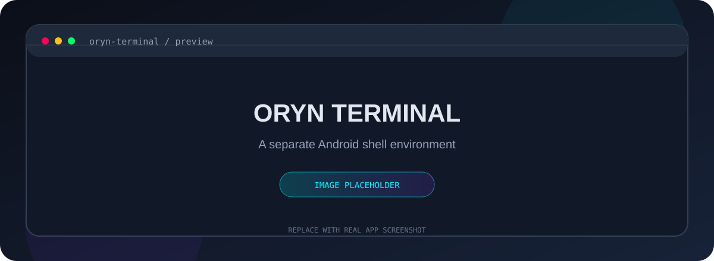
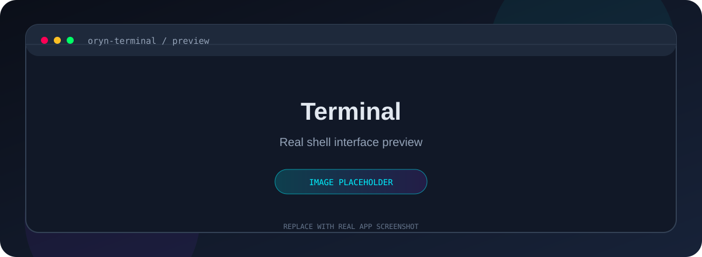
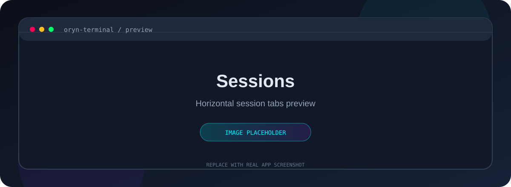
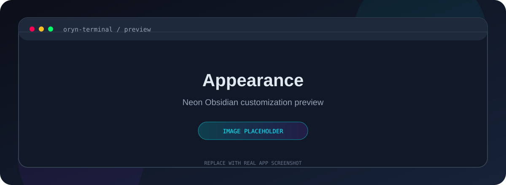
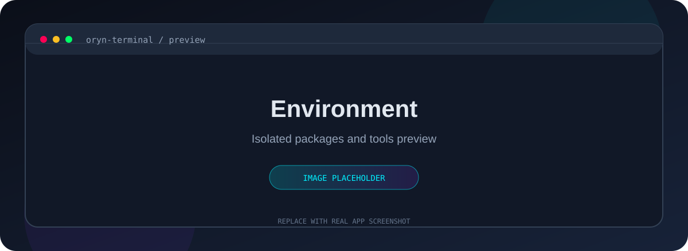
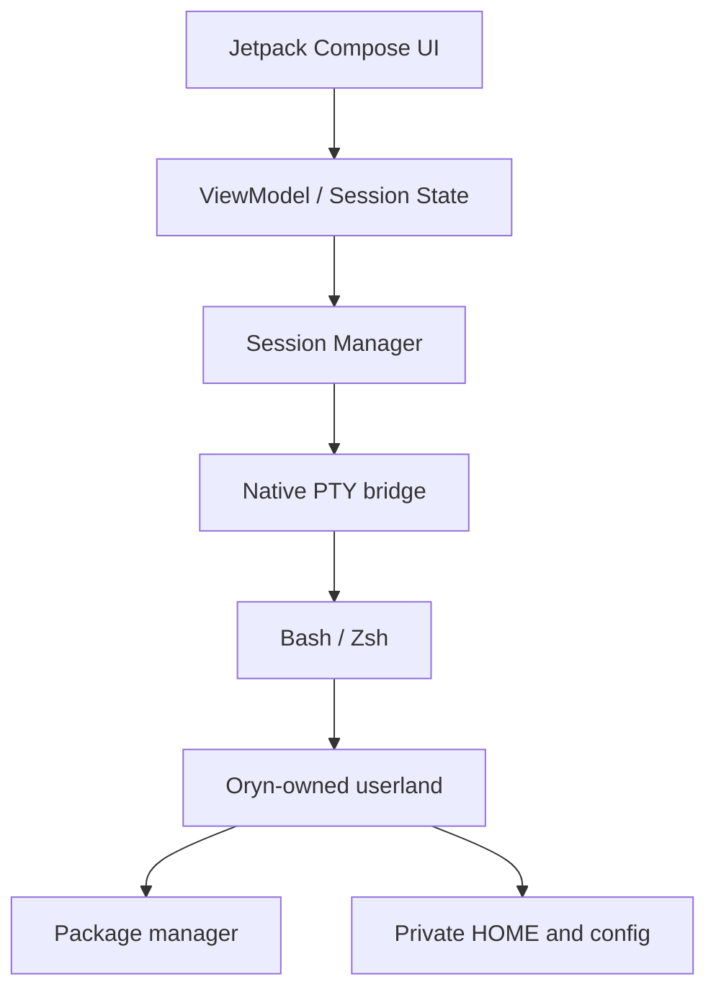

<p align="center">
  
</p>

<h1 align="center">Oryn Terminal</h1>

<p align="center">
  <strong>Your Android terminal. Your environment. Your rules.</strong><br>
  An independent, developer-focused Android terminal built to coexist with Termux — never replace it.
</p>

<p align="center">
  <a href="https://github.com/ja3kies/Oryn-Terminal/actions"></a>
  
  
  
  
</p>

<p align="center">
  <a href="#-the-idea">The idea</a> ·
  <a href="#-at-a-glance">At a glance</a> ·
  <a href="#-features">Features</a> ·
  <a href="#-screenshots">Screenshots</a> ·
  <a href="#-architecture">Architecture</a> ·
  <a href="#-build">Build</a> ·
  <a href="#-roadmap">Roadmap</a>
</p>

---

## ✦ The idea

Oryn Terminal is a standalone Android terminal for people who want a capable command-line environment without sacrificing the Termux installation they already rely on.

It is designed around one non-negotiable rule:

> **Oryn and Termux are two completely separate apps, with two completely separate environments.**

Oryn gets its own Android application identity, private storage, home directory, package prefix, shell configuration, installed packages and terminal sessions. It must never overwrite, migrate, uninstall, or write into the user's existing Termux data.

The project is currently in its foundation phase. The interface and architecture are being built before the terminal runtime is considered production-ready.

## ✦ At a glance

| Design | Runtime | Isolation | Developer workflow |
|:--|:--|:--|:--|
| Neon Obsidian visual system | Native Android PTY target | Independent app sandbox | Bash by default |
| Jetpack Compose + Material 3 | Real interactive shell | Separate `$HOME` and prefix | Optional Zsh |
| Restrained cyan / purple accents | ANSI terminal rendering | No dependency on installed Termux | Git, SSH, Python, Node.js, Java |
| Touch-first, keyboard-friendly UI | Multiple concurrent sessions | Package state owned by Oryn | Gradle and local servers |

<sub>Planned capabilities are targets, not claims that they are already implemented.</sub>

## ✦ Features

### ◈ A real terminal, not a terminal-shaped demo

- **PTY-backed shell sessions** — interactive commands, job control, signals and terminal resizing.
- **Bash first** — a familiar default shell, with Zsh available as an optional install.
- **ANSI support** — colors, cursor movement and terminal escape sequences.
- **Session management** — multiple independent sessions with separate process state.

### ◈ Built for multitasking

- **Horizontal session tabs** — switch sessions from the top of the screen; no permanent vertical sidebar.
- **Session controls** — create, close and rename sessions.
- **Background continuity** — preserve running sessions when navigating around the app, subject to Android process lifecycle limits.
- **Per-session state** — independent working directories and session metadata.

### ◈ A self-contained developer environment

- **Termux-compatible package workflow** — a dedicated package environment owned by Oryn.
- **Developer tools** — Git, SSH, Python, Node.js, Java/Kotlin, Gradle, Nano and Vim.
- **Local development** — run scripts and local servers directly on the device.
- **Storage access** — explicit Android storage permissions and user-controlled access.

### ◈ Your terminal, your setup

- Light and dark appearance options.
- Monospace font, text size and line spacing controls.
- Cursor and terminal color customization.
- Configurable shell and tab behavior.
- Copy, paste, text selection, command history and extra keys.

## ✦ Screenshots

These are temporary placeholders. They will be replaced with real device screenshots as the UI is implemented.

<table>
  <tr>
    <td align="center" width="50%">
      
      <sub><strong>Terminal</strong> · Main shell interface</sub>
    </td>
    <td align="center" width="50%">
      
      <sub><strong>Sessions</strong> · Horizontal tab management</sub>
    </td>
  </tr>
  <tr>
    <td align="center" width="50%">
      
      <sub><strong>Appearance</strong> · Personalization controls</sub>
    </td>
    <td align="center" width="50%">
      
      <sub><strong>Environment</strong> · Independent packages and tools</sub>
    </td>
  </tr>
</table>

## ✦ Neon Obsidian

A dark, focused interface with a small number of expressive accents. Neon is used for state and interaction — never at the expense of terminal readability.

| Token | Color | Purpose |
|:--|:--:|:--|
| Background | `#0B0F19` | Main canvas |
| Surface | `#111827` | Primary surfaces |
| Elevated surface | `#1E293B` | Cards and controls |
| Primary text | `#E2E8F0` | Main content |
| Secondary text | `#94A3B8` | Supporting content |
| Cyan | `#00F0FF` | Active state and focus |
| Purple | `#8338EC` | Secondary accent |
| Error | `#FF0055` | Errors |
| Success | `#00FF66` | Successful actions |

## ✦ Architecture

The intended runtime is split into clear boundaries so the UI never owns shell-process logic.



### Isolation contract

- Application ID: `com.oryn.terminal`
- Private files, cache, preferences and session metadata belong to Oryn.
- The existing Termux package and its data are out of bounds.
- Any compatibility path mapping must happen inside Oryn's own proot environment.
- Package bootstrap archives must be pinned and checksum-verified before extraction.

### Technology direction

| Layer | Technology |
|:--|:--|
| Language | Kotlin |
| UI | Jetpack Compose + Material 3 |
| Android minimum | API 26 target, subject to device testing |
| Terminal process | Native PTY bridge (prototype evaluation) |
| Userland compatibility | Termux packages via isolated proot mapping (under validation) |
| Build | Gradle / Android Gradle Plugin |
| Target ABI | ARM64 first |

## ✦ Build

The Android project scaffold is being established. Build instructions will be finalized once the Gradle wrapper and CI pipeline are committed.

Planned local build command:

```bash
./gradlew assembleDebug
```

The first verified build will be an installable ARM64 debug APK. A successful APK build alone will not count as proof that shell execution or package installation works.

## ✦ Roadmap

- [x] Product requirements and isolation contract
- [x] Compare terminal foundations and document technical risks
- [x] Establish repository README and visual direction
- [ ] Create Android application scaffold with Oryn identity
- [ ] Integrate and validate native PTY engine
- [ ] Verify independent app storage and Termux coexistence
- [ ] Replace outdated bootstrap with a pinned, verified release
- [ ] Validate Bash and real package-manager operations on ARM64
- [ ] Build horizontal session tabs and session lifecycle
- [ ] Add Zsh and developer tool presets
- [ ] Add settings, accessibility and terminal customization
- [ ] Add automated tests and reproducible CI builds
- [ ] Produce a tested release APK

## ✦ Project status

Oryn Terminal is an early-stage personal project. Features listed above describe the intended product; they should not be interpreted as already available.

The current engineering priority is correctness: a truly independent environment, a reliable PTY lifecycle, safe bootstrap installation and real package operations. Visual polish comes after those foundations are verified.

---

<p align="center">
  <strong>ORYN TERMINAL</strong><br>
  <sub>Independent by design. Built for the command line.</sub>
</p>
