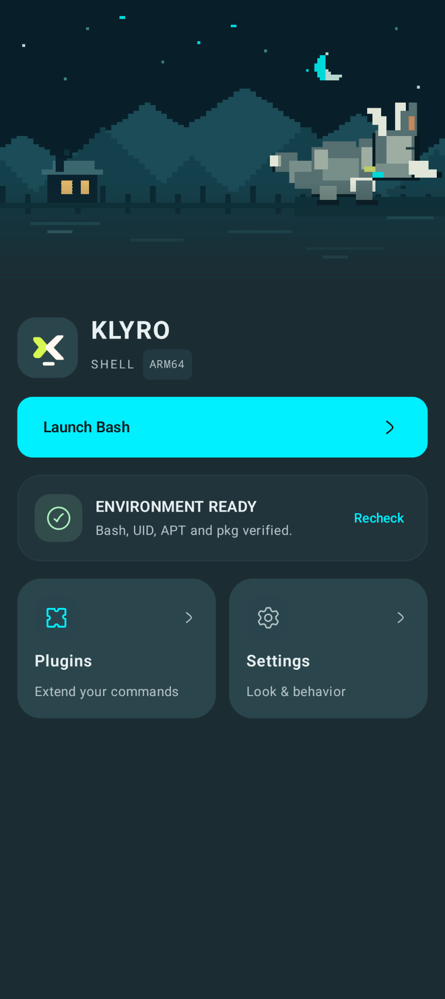
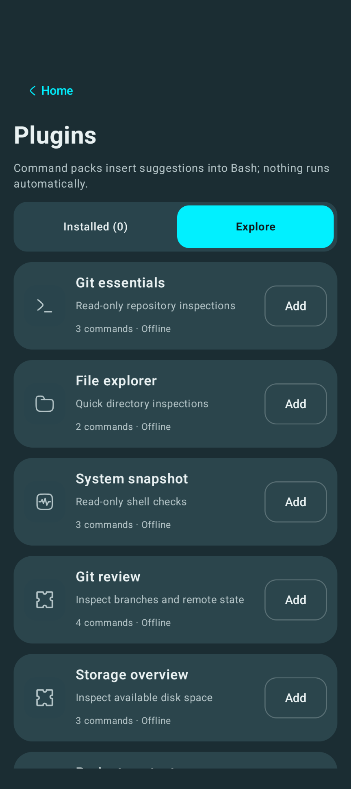

# Home and Plugins: capture-based refinement

Evidence: the user supplied these two Android screenshots in this conversation.
Both were opened and inspected. Their APK version and source commit are unknown;
they are baseline visual evidence, not proof of the new implementation.

## 1. Home — clear main action, secondary hierarchy too heavy

The pixel landscape and mascot give Home a recognizable identity. Launch Bash
is visible and clearly primary. ARM64 adds technical metadata next to the brand,
while the all-caps ready panel competes with navigation. The lower empty area
does not justify adding unrelated widgets.

Change: retain the art and CTA; use the selected workspace as useful context;
use sentence-case status labels; make a healthy status quieter. Keep full
error, warning, checking, installation and repair feedback.

## 2. Plugins Explore — readable, but selection overpowers the catalog

The saturated selected tab dominates repeated neutral Add buttons. Repeating
Offline on every card adds noise. The generic puzzle icon does not distinguish
Git review, storage or project context. The current single-row card needs an
explicit layout escape at large text sizes. The screenshot alone does not prove
how it behaves when scrolled, enlarged, loading, disabled or reporting errors.

Change: outlined selection with a neutral fill, Explore first; offline context
once in the introduction; relevant existing glyphs; compact icon wells; stack
Add below the heading on narrow layouts or at large font scales. Keep navigation
visible normally and allow the entire page to scroll on short/large-text layouts.
Move destructive removal below the enabled switch and name the pack accessibly.

## Simulated five-designer review of these baseline captures

These are review perspectives, not quotes or endorsements.

| Perspective | Finding | Implementation direction |
| --- | --- | --- |
| Rams | Home metadata and repeated Offline compete with useful content | Workspace context and less repetition |
| Ive | Status panel and selected tab carry too much visual weight | Quieter ready state and outlined selection |
| Kare | Mascot supplies identity; generic pack glyphs blur distinctions | Preserve pixel art; use relevant pack icons |
| Wroblewski | Primary action is obvious; navigation should remain reachable | Keep CTA prominent and provide scroll escapes |
| Norman | Installed/error/loading states need to remain distinguishable | Truthful counts, retry and explicit confirmations |

No composition score is assigned to the modified UI before inspecting its real
Android render. The target remains at least 8.5/10.

## Code findings beyond the screenshots

The registry reader caught parsing failures and returned an empty list. A later
write could replace unreadable data. Reads now reject malformed, invalid,
duplicate or oversized registries; writes use that strict path. The terminal
suggestion lookup alone keeps a safe empty fallback. The page offers Retry and
does not show a failed read as Nothing installed yet. Removal confirmation is
not resolved against an unfinished or failed registry snapshot. Timeout recovery
also catches read failures.

## Verification

- Python source/robot regressions run separately from Android tests.
- Android tests added: large-font Add placement and 48dp target; installed Add
  disabled; real isolated SharedPreferences error/retry/recovery; unreadable and
  invalid registries cannot be overwritten and do not crash suggestion lookup.
- The test registry uses a unique preference namespace; user plugin data is not
  used or modified.
- Required next evidence: new Home and Explore renders, Installed, add/cancel,
  remove/cancel, registry error/retry, light/dark, 200% text, landscape, motion and
  background/resume. Compilation is not instrumented execution.
- Settings and terminal remain subsequent stages. Preserve Klyro's keyboard.

## Capture integrity

- Home (`71238.png`): SHA-256
  `db2db89ba3d8f980b2d83ac1af51dc5844beca97960e3142e9be230f77067c06`.
- Explore (`71239.png`): SHA-256
  `3bc6b4460a8ec85b4d1ae117e14b4873e30b4231c1a49ca9342ad49e7d9fe7ac`.
